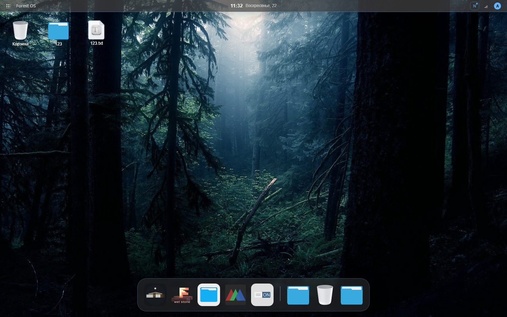
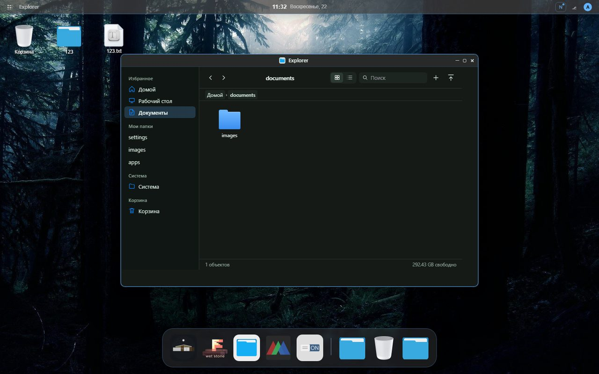
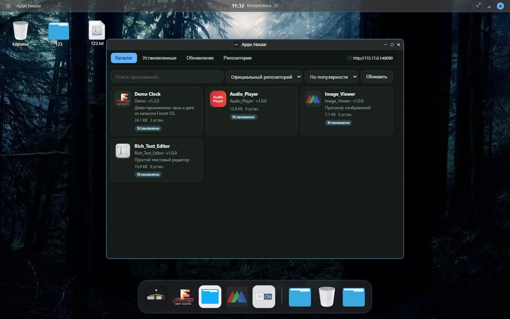
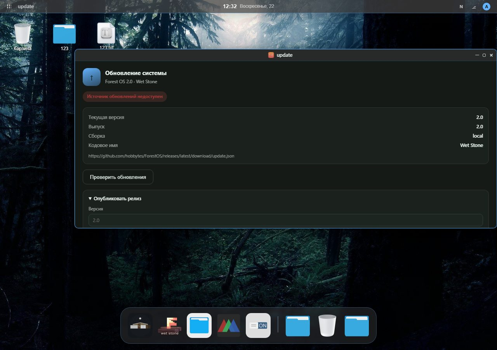
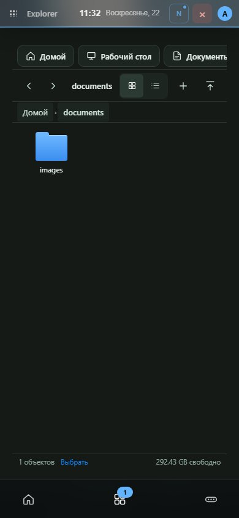

# Forest OS

**Forest OS** — веб-операционная система: рабочий стол в браузере, окна, док,
проводник, редактор, просмотрщик изображений, плеер, магазин приложений и
визуальный **Node-режим**, в котором приложения соединяются в граф данных.

Написана на PHP 8 и чистом JavaScript, без сборщиков и фреймворков: склонировал —
поднял контейнеры — работаешь.

> A browser-based desktop OS in PHP + JS, with a visual node/dataflow mode,
> mobile shell and a dark theme. Docker-first setup, no build step.



---

## Скриншоты

| Проводник | Настройки |
|---|---|
|  |  |

| Магазин приложений | Обновление системы |
|---|---|
|  |  |

| Node-режим: файл из проводника сразу открывается в просмотрщике |
|---|
|  |

| Мобильный рабочий стол | Приложение | Список запущенных |
|---|---|---|
|  |  |  |

---

## Стандартные приложения

В системе «из коробки» только четыре приложения — остальное ставится из магазина:

| Приложение | Что делает |
|---|---|
| **Explorer** (Проводник) | файлы и папки, избранное, корзина, ассоциации, выбор файла для других приложений |
| **Settings** (Настройки) | темы и акцент, тёмная тема, док, автозапуск, язык и время, пользователи, блокировка учёток, ключи доступа, управление приложениями |
| **Apps House** (Магазин) | каталог, установка и удаление приложений, публикация своих |
| **Update** (Обновление) | версия и сборка, проверка источника обновлений, установка пакета |

Эти четыре приложения защищены от удаления (`AppStore::PROTECTED_APPS`).

### Приложения из комплекта

В репозитории есть папка `catalog/` — локальный каталог с пакетами, которые
**не установлены сразу**, но ставятся из **Apps House → источник «В комплекте»**
(без интернета, за пару секунд):

| Приложение | Что делает |
|---|---|
| **Rich Text Editor** | текстовый редактор с форматированием и сохранением в файл |
| **Image Viewer** | просмотр изображений, масштаб, установка картинки на рабочий стол |
| **Audio Player** | mp3, wav, ogg, aac |
| **Converter** | перевод старых приложений на переменные темы |
| **Demo Clock** | демо-приложение: часы и дата |
| **Picker Test** | пример выбора файла через Mercury `AppGUI` |

Свой каталог добавить просто: положите `catalog/apps/<Имя>.zip` (содержимое папки
приложения) и опишите его в `catalog/index.json` — магазин увидит пакет и поставит
его одной кнопкой.

---

## Возможности

**Рабочий стол и окна**
* перетаскиваемые окна с изменением размера, свёртывание «в плашку», z-order;
* сетка рабочего стола: ярлыки не накладываются, но двигаются свободно;
* контекстные меню везде, создание папок и файлов прямо на столе;
* динамическое обновление дока и рабочего стола без перезагрузки.

**Node-режим** (`Ctrl+Shift+N`)
* у приложений есть входы и выходы; на окнах и на элементах появляются якоря;
* перетаскивание соединяет выход с входом, значения текут по связям;
* кнопки умеют быть действиями (пришло значение → нажатие) и событиями (нажали → значение ушло);
* приложение принимает файл стандартно — перезапуском с ключом `defaultloader`;
* два режима: «Авто» и «По запуску» (очередь + «Выполнить»);
* пространства (окна + связи) сохраняются и восстанавливаются.

**Мобильный режим (≤ 760 px)**
* приложения — полноэкранные, без оконных рамок;
* нижняя панель: рабочий стол, запущенные приложения, док;
* свайп от края переключает приложения, долгое нажатие = контекстное меню;
* список запущенных приложений с закрытием одного или всех.

**Оформление**
* темы (`system/core/design/themes/*.fth`), акцентный цвет, тёмная тема;
* конвертер старых приложений переводит их на CSS-переменные темы.

---

## Быстрый старт (Docker)

```bash
git clone https://github.com/hobbytes/ForestOS.git
cd ForestOS
cp .env.example .env      # и обязательно поменяйте пароли в .env
docker compose up -d --build
```

Открыть `http://localhost:8080` (порт задаётся в `.env` → `APP_PORT`).

При первом запуске контейнер сам:
* создаёт схему БД,
* создаёт суперпользователя из `FOREST_ADMIN_LOGIN` / `FOREST_ADMIN_PASSWORD`,
* генерирует `system/core/library/bd_inc.php`,
* создаёт дерево пользователя и док по умолчанию.

Логин — тот, что указан в `.env`.

### Требования

| Что | Версия |
|---|---|
| Docker | 24+ (compose v2) |
| PHP (без Docker) | 8.1+ с `pdo_mysql`, `mbstring`, `curl`, `zip` |
| MySQL / MariaDB | 10.4+ |

---

## Установка без Docker

1. Скопируйте файлы в корень сайта (Apache + `mod_rewrite`, `AllowOverride All`).
2. Создайте `.env` по образцу `.env.example` (или задайте переменные окружения).
3. Включите короткие PHP-теги: `short_open_tag = On` (проект исторически использует `<?
   ?>`), `display_errors = Off`.
4. Выполните `php bin/forest-bootstrap.php` — создастся БД, админ и каталоги.
5. Откройте сайт в браузере.

`.env`, `Dockerfile`, `docker-compose.yml`, `sql/`, `docs/`, `bin/` закрыты от
доступа по HTTP правилами `.htaccess`.

---

## Структура

```
os.php                     вход в рабочий стол
login.php                  форма входа (логин/пароль или одноразовый ключ)
bin/forest-bootstrap.php   первичная настройка: БД, админ, каталоги
sql/001_forestusers.sql    схема таблицы пользователей
docker/                    php.ini, конфиг Apache, entrypoint
system/core/library/       ядро: AppContainer, окна, темы, Mercury, JS-оболочка
system/core/functions/     AJAX-эндпоинты (настройки, док, узел, файлы стола…)
system/core/design/        CSS, картинки, темы (.fth)
system/apps/<App>/         приложения; из коробки — Explorer, Settings, Apps_House, update
catalog/                   локальный каталог: index.json + apps/*.zip + icons/*.png
system/users/<login>/      данные пользователя (не хранится в git)
docs/                      документация и скриншоты
```

---

## Разработка

Всё статично: PHP отдаётся как есть, JS — без сборки. Правки в файлах сразу видны
после обновления страницы (кэш CSS/JS сбрасывается параметром `?h=`).

* стиль кода — см. `CONTRIBUTING.md`;
* не коммитьте `.env`, `system/users/*`, `data/*`, `bd_inc.php`, `instance.foc`;
* секреты и приватные данные — только в `.env` (в репозиторий попадает `.env.example`).

---

## Лицензия

См. [LICENSE](LICENSE).
