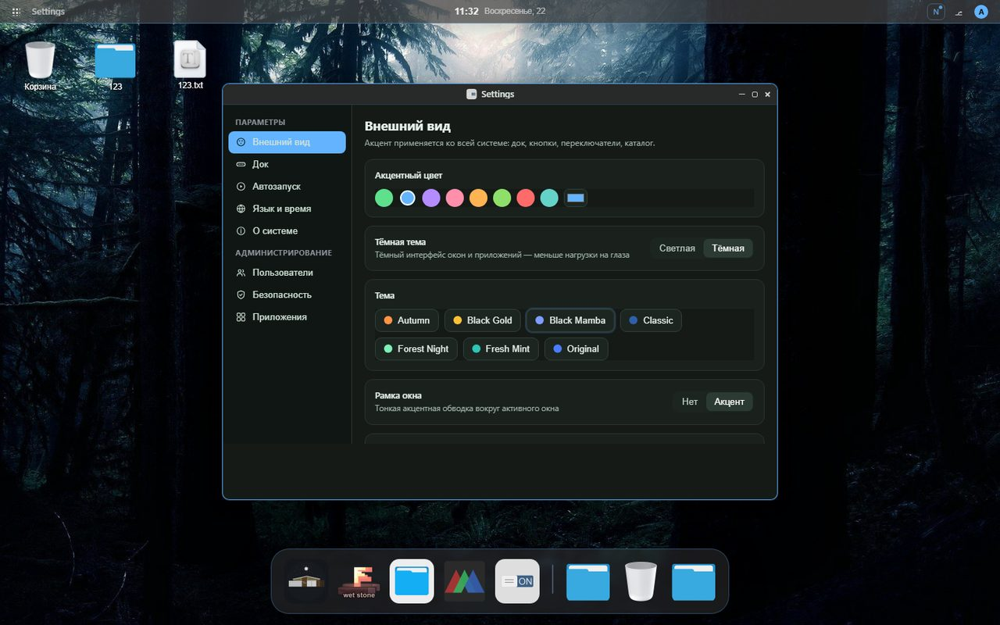
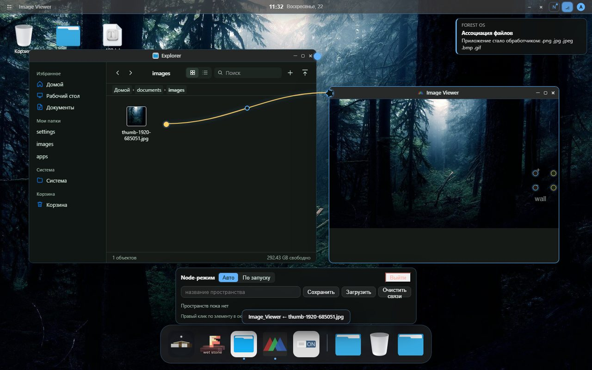
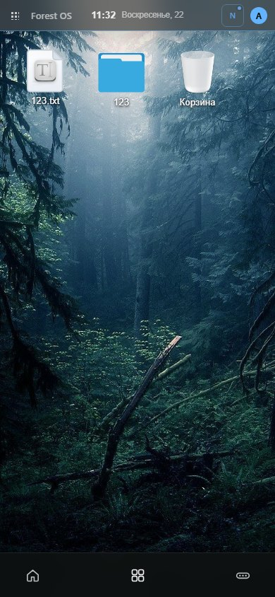
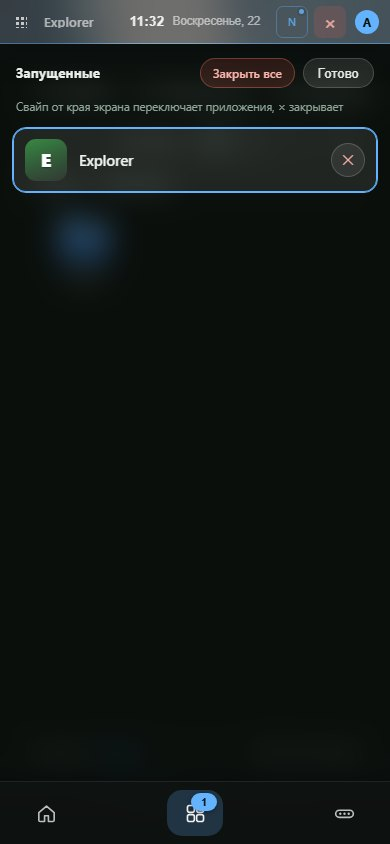

# Forest OS

**Forest OS** — веб-операционная система: рабочий стол в браузере, окна, док,
проводник, редактор, просмотрщик изображений, плеер, магазин приложений и
визуальный **Node-режим**, в котором приложения соединяются в граф данных.

Написана на PHP 8 и чистом JavaScript, без сборщиков и фреймворков: склонировал —
поднял контейнеры — работаешь.

> A browser-based desktop OS in PHP + JS, with a visual node/dataflow mode,
> mobile shell and a dark theme. Docker-first setup, no build step.


---

## Скриншоты

| Проводник | Настройки |
|---|---|
|  |  |

| Магазин приложений | Обновление системы |
|---|---|
|  |  |

| Node-режим: файл из проводника сразу открывается в просмотрщике |
|---|
|  |

| Мобильный рабочий стол | Приложение | Список запущенных |
|---|---|---|
|  |  |  |

---

## Возможности

**Рабочий стол и окна**
* перетаскиваемые окна с изменением размера, свёртывание «в плашку», z-order;
* сетка рабочего стола: ярлыки не накладываются, но двигаются свободно;
* контекстные меню везде, создание папок и файлов прямо на столе;
* динамическое обновление дока и рабочего стола без перезагрузки.

**Node-режим** (`Ctrl+Shift+N`)
* у приложений есть входы и выходы; на окнах и на элементах появляются якоря;
* перетаскивание соединяет выход с входом, значения текут по связям;
* кнопки умеют быть действиями (пришло значение → нажатие) и событиями (нажали → значение ушло);
* приложение принимает файл стандартно — перезапуском с ключом `defaultloader`;
* два режима: «Авто» и «По запуску» (очередь + «Выполнить»);
* пространства (окна + связи) сохраняются и восстанавливаются.

**Мобильный режим (≤ 760 px)**
* приложения — полноэкранные, без оконных рамок;
* нижняя панель: рабочий стол, запущенные приложения, док;
* свайп от края переключает приложения, долгое нажатие = контекстное меню;
* список запущенных приложений с закрытием одного или всех.

**Оформление**
* темы, акцентный цвет, тёмная тема;
* конвертер старых приложений переводит их на переменные темы.

---

## Приложения

«Из коробки» в системе четыре приложения:

| Приложение | Что делает |
|---|---|
| **Explorer** (Проводник) | файлы и папки, избранное, корзина, ассоциации, выбор файла для других приложений |
| **Settings** (Настройки) | темы и акцент, тёмная тема, док, автозапуск, язык и время, пользователи, блокировка учёток, ключи доступа |
| **Apps House** (Магазин) | каталог, установка и удаление приложений, публикация своих |
| **Update** (Обновление) | версия системы, что нового, установка обновления |

Всё остальное — Rich Text Editor, Image Viewer, Audio Player, Converter, примеры
и сторонние приложения — живёт в **Apps House** и ставится оттуда в один клик.
Стандартные приложения обновляются вместе с системой.

Своё приложение публикуется в магазине: **Apps House → Опубликовать**.

---

## Установка

### Docker (рекомендуется)

```bash
git clone https://github.com/hobbytes/ForestOS.git
cd ForestOS
cp .env.example .env      # и обязательно поменяйте пароли
docker compose up -d --build
```

Открыть `http://localhost:8080` (порт — `APP_PORT` в `.env`). При первом запуске
система сама создаст базу, суперпользователя и рабочий стол.

**Логин и пароль** — те, что вы указали в `.env` (`FOREST_ADMIN_LOGIN` /
`FOREST_ADMIN_PASSWORD`). Если оставили значения из `.env.example`, это
`admin` / `change_me_admin_password` — обязательно смените пароль после входа
(**Настройки → Безопасность**).

После установки система печатает данные для входа в лог:

```bash
docker compose logs web | tail -20
```

### Смена пароля администратора

Пароль из `.env` применяется только при первой установке. Если система уже
установлена, база хранит прежний пароль, и правка `.env` его не меняет. Сменить:

```bash
docker compose exec web php bin/forest-password.php
```

Скрипт возьмёт логин и новый пароль из `.env` (или спросит их) и обновит учётную
запись. Альтернатива — `FOREST_ADMIN_PASSWORD_RESET=1` в `.env` и перезапуск
контейнера: пароль существующего администратора обновится автоматически.

Пароль также можно сменить в системе: **Настройки → Безопасность**.

---

### Без Docker

Apache с `mod_rewrite` и `AllowOverride All`, PHP 8.1+ (`pdo_mysql`, `mbstring`,
`curl`, `zip`), MySQL/MariaDB 10.4+.

1. Скопируйте файлы в корень сайта.
2. Создайте `.env` по образцу `.env.example`.
3. Включите `short_open_tag = On` и `display_errors = Off`.
4. Выполните `php bin/forest-bootstrap.php`.
5. Откройте сайт в браузере.

---

## Разработка приложений

Приложение — папка в `system/apps/` c `main.php` (и, по желанию, `assets/`, `lang/`,
`app.png`). Цвета берутся из переменных темы, поэтому приложение сразу работает
в светлом и тёмном оформлении.

```php
$AppContainer = new AppContainer;
$AppContainer->AppNameInfo = 'My App';
$AppContainer->StartContainer();
// ... ваш интерфейс ...
$AppContainer->EndContainer();
```

* файл приложению передаётся параметром `defaultloader` (путь от корня сайта);
* входы и выходы для Node-режима помечаются на элементах:
  `data-fo-in`, `data-fo-out`, `data-fo-action`, `data-fo-event`;
* оформление — `var(--fo-win-body)`, `var(--fo-text)`, `var(--fo-accent)`;
* подробности и правила — в [CONTRIBUTING.md](CONTRIBUTING.md).

---

## Обновления

Обновления выходят через приложение **Update**: там видно текущую версию,
доступное обновление и что в нём нового, а установка занимает один клик.
Пользовательские файлы, настройки и база при этом сохраняются.

Релизы публикует владелец инсталляции — из интерфейса Update или командой
`php bin/release.php`. Технические детали — в [docs/RELEASES.md](docs/RELEASES.md).

---

## Лицензия

См. [LICENSE](LICENSE).
